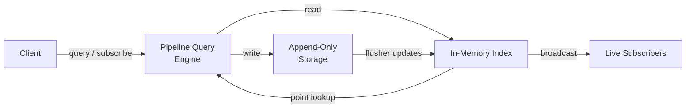

<p align="center">
  <picture>
    <source media="(prefers-color-scheme: dark)" srcset="./assets/logo.svg">
    
  </picture>
  <br/>
  <strong>LivenDB</strong>
</p>

<p align="center">
  <a href="https://github.com/livendb/liven/actions/workflows/build.yml">
    
  </a>
  <a href="https://github.com/livendb/liven/pkgs/container/liven">
    
  </a>
  <a href="https://crates.io/crates/liven">
    
  </a>
  <a href="https://www.npmjs.com/package/@livendb/liven-client">
    
  </a>
  <a href="https://pypi.org/project/liven-client">
    
  </a>
  <a href="https://pkg.go.dev/github.com/livendb/liven-go">
    
  </a>

</p>

---

> **Stream. Process. Store. One Engine.**

Liven is a database built for data that moves. It ingests streaming data, transforms it on the fly, and stores it durably — all with a single pipeline query language. One binary.

```sh
# Install via crates.io
cargo install liven

# One-liner install
curl --proto '=https' --tlsv1.2 -sSfL https://livendb.com/install | sh

# Install via Docker
docker pull ghcr.io/livendb/liven:latest
docker run -p 43121:43121 -p 43120:43120 -v ./data:/var/lib/liven livendb/liven:latest

# Launch the server
liven start
```

---

## Why Liven?

Databases today make you choose: batch or stream? Historical or real-time? Key-value or vector? Liven was built to erase those lines.

**One query language, two modes:**

- Historical queries against stored data
- Real-time subscriptions on the same pipeline — just add `.listen()`

**One engine, three deployment models:**

- Embedded library — runs inside your Rust process
- Network server — TCP + WebSocket, thousands of clients
- Interactive TUI or web dashboard — for ad-hoc queries and monitoring

**Built-in capabilities that usually require separate systems:**

- Vector similarity search (int8 quantized, cosine similarity)
- Stream joins (time-bounded correlate, multi-hop chain)
- Event pattern detection (sequence FSM)
- Time-windowed aggregations
- Full-text substring matching

---

## Quick Start

```bash
# One-liner install
curl --proto '=https' --tlsv1.2 -sSfL https://livendb.com/install | sh

# Or via Docker
docker run -p 43121:43121 -p 43120:43120 ghcr.io/livendb/liven

# Or build from source
cargo build --release
./target/release/liven start
# → Open http://localhost:43120
# → Admin auth key printed on first start — save it

# Insert and query via the embedded Web UI at http://localhost:43120

# Or use the interactive TUI shell
liven vibe

# Tail a stream in real time
liven tail events

# List streams
liven list
```

### Embedded in Rust

Add the dependency with the features you need:

```toml
[dependencies]
liven = "0.1.2"                        # full build (server, TUI, TLS)
```

For a minimal embedded build with no server, TUI, or TLS:

```toml
[dependencies]
liven = { version = "0.1.2", default-features = false }      # core only
```

Select individual features:

```toml
[dependencies]
liven = { version = "0.1.2", default-features = false, features = ["tls"] }   # core + TLS
liven = { version = "0.1.2", default-features = false, features = ["server", "tls"] }  # core + server + TLS
liven = { version = "0.1.2", features = ["tui"] }  # full + TUI (already included)
```

---

## Rust Crate API

Liven provides two usage modes via the same unified method signatures:

| Mode         | Initialization                                   | Runtime                      |
| ------------ | ------------------------------------------------ | ---------------------------- |
| **Embedded** | `Liven::open("./data")?`                         | In-process, no server needed |
| **Wire**     | `LivenClient::connect("127.0.0.1:43121").await?` | Remote server over TCP       |

Both modes expose the same methods (`insert`, `get`, `filter`, `enrich`, etc.) —
the embedded versions are synchronous, the wire versions are async.

```rust
use liven::Liven;
use liven::client::LivenClient;
use liven::query::{Pipeline, Filter};
use serde_json::json;

// ── Embedded ──
let db = Liven::open("./data")?;
db.insert("events", "e1", json!({"type": "click"}))?;
let results = db.run(
    Pipeline::from("events")
        .filter(Filter::field("type").eq("click"))
        .limit(10)
        .build(),
)?;

// ── Wire (async) ──
let mut client = LivenClient::connect("127.0.0.1:43121").await?;
client.insert("events", "e1", json!({"type": "click"})).await?;
let results = client.run(
    &Pipeline::from("events")
        .filter(Filter::field("type").eq("click"))
        .limit(10)
        .build(),
).await?;
```

> **Tip:** Use `db.query("...")` for ad-hoc string queries and `db.insert(...)` / `db.get(...)` etc.
> for the typed API. Both work identically in embedded mode and over the wire.

### Connection URL

The wire client supports connection URLs with optional auth key:

```rust
// Plain TCP
LivenClient::connect("127.0.0.1:43121").await?;

// With auth key in URL
LivenClient::connect("127.0.0.1:43121?auth_key=my_secret").await?;
```

### CRUD operations

```rust
// ── Embedded ──        // ── Wire (async) ──
db.insert("users", "u1", json!({"name":"Alice"}))?;
                        // client.insert("users", "u1", json!(...)).await?;

db.upsert("users", "u1", json!({"name":"Alice"}))?;
db.update("users", "u1", json!({"status":"active"}))?;
db.get("users", "u1")?;
db.delete("users", "u1")?;
db.clear("logs")?;
db.drop_stream("temp")?;
db.insert_many("orders", vec![("o1".into(), json!({"amount":100}))])?;
db.upsert_many("orders", vec![("o1".into(), json!({"amount":200}))])?;

// Metadata
db.streams()?;
db.status()?;
```

### Pipeline operations

```rust
use liven::query::{Pipeline, Filter};
use liven::types::AggregateStrategy;

// ── Embedded ──                    // ── Wire (async) ──
db.filter("events",                   // client.filter("events",
    Filter::field("type").eq("click"), //   Filter::field("type").eq("click"),
)?;                                     // ).await?;

db.limit("events", 10)?;             // client.limit("events", 10).await?;
db.count("events")?;                  // client.count("events").await?;
db.sort("events", "timestamp", true)?; // client.sort("events","timestamp",true).await?;
db.page("events", 1, 50)?;           // client.page("events", 1, 50).await?;
db.map("users", vec!["name".into(), "email".into()])?;
db.window("metrics", 60_000, AggregateStrategy::avg())?;
db.group("events", "type", vec!["count".into()])?;
db.distinct("users", "email")?;
db.page_cursor("events", "cursor_abc", 50)?;

// Vector similarity
db.vector_filter("embeddings", "vector", vec![12, -5, 3], 0.85)?;

// Stream joins
db.enrich("logs", "users", "user_id")?;
db.correlate("events", "orders", "user_id", 5000)?;
db.chain("prompts", "responses", "prompt_id")?;
db.sequence("system_events",
    vec![Filter::field("event").eq("disk_full"),
         Filter::field("event").eq("crash")],
    10_000)?;
```

### Pipeline builder (for complex chains)

When you need multiple stages, use the builder and execute with `db.run()`:

```rust
use liven::query::{Pipeline, Filter};

let pipeline = Pipeline::from("orders")
    .filter(Filter::field("amount").gte(100.0))
    .filter(Filter::field("status").eq("completed"))
    .sort("amount", true)
    .limit(10);

// Embedded
db.run(pipeline.clone().build())?;

// Wire
client.run(&pipeline.build()).await?;
```

### Pipeline update / delete

```rust
let pipeline = Pipeline::from("orders")
    .filter(Filter::field("status").eq("pending"));

// Update all matching records
db.pipeline_update(pipeline.clone(), json!({"status": "cancelled"}))?;

// Delete all matching records
db.pipeline_delete(pipeline)?;
```

### Explain

```rust
use liven::types::Query as Q;

let plan = db.explain(Q::insert("events", "e1", json!({"x": 1})))?;
```

### Real-time subscriptions

```rust
use liven::query::{Pipeline, Filter};

// Blocking subscription (embedded, non-async)
loop {
    let next = db
        .subscribe_sync(std::time::Duration::from_millis(100))
        .expect("subscription failed");
    if let Some(record) = next {
        println!("New: {}", record.key);
    }
}

// Async subscription (embedded)
let mut rx = db.subscribe();
tokio::spawn(async move {
    while let Ok(record) = rx.recv().await {
        println!("Live: {:?}", record);
    }
});

// Wire streaming (client)
use futures_util::StreamExt;
let mut stream = client.listen("events").await?;
while let Some(Ok(record)) = stream.next().await {
    println!("Got: {}", record.key);
}
```

### Custom configuration

```rust
use liven::embed::{LivenConfig, Liven};

let config = LivenConfig {
    max_streams: 128,
    max_index_ram_mb: 1024,
    ..Default::default()
};
let db = Liven::open_with_config("./data", config)?;
```

### Full example

```rust
use liven::Liven;
use liven::query::{Pipeline, Filter};
use serde_json::json;

fn main() -> Result<(), Box<dyn std::error::Error>> {
    let dir = format!("./liven_demo_{}", std::process::id());
    let db = Liven::open(&dir)?;

    // Insert
    db.insert("events", "e1", json!({"type": "click", "value": 10}))?;
    db.insert("events", "e2", json!({"type": "purchase", "value": 50}))?;
    db.insert("events", "e3", json!({"type": "click", "value": 20}))?;

    // Query
    let clicks = db.filter("events", Filter::field("type").eq("click"))?;
    println!("Clicks: {:?}", clicks);

    // Count
    let count = db.count("events")?;
    println!("Total: {:?}", count);

    let _ = std::fs::remove_dir_all(&dir);
    Ok(())
}
```

**[Full API documentation &rarr;](https://docs.rs/liven)**

---

## How It Works (at a glance)



- **Writes** are appended to segment files. A background flusher batches them for throughput without sacrificing durability.
- **Reads** go through a lock-free in-memory index. Point lookups resolve in microseconds.
- **Subscriptions** broadcast every write to all listeners. The server evaluates pipeline filters before delivery.
- **Compaction** rewrites live records into a new segment and drops superseded
  versions. The server runs it in the background once the configured thresholds
  are exceeded; embedded callers opt in with `db.start_auto_compact(...)` or call
  `db.compact()` directly.
- **Recovery** replays segments on startup. Checksums catch corruption.

---

## Benchmarks

Microbenchmarks run in a pinned Docker image (`rust:1.88-bookworm`), built with
`-C target-cpu=x86-64`, `lto = "fat"` and `codegen-units = 1`, on a GitHub-hosted
`ubuntu-latest` runner. Values are Criterion medians from run
[39969013537](https://github.com/livendb/liven/actions/runs/39969013537)
(commit `3a6fea2`, 2026-10-23). The exact runner CPU model is not recorded in the
artifact — treat these as relative, not absolute, numbers.

| Operation                          | Performance          | Notes                                         |
| ---------------------------------- | -------------------- | --------------------------------------------- |
| **Point lookup** (existing key)    | **~1.7 µs**          | 1.71 µs at 1K keys, 1.69 µs at 10K keys       |
| **Point lookup** (missing key)     | **~80–120 ns**       | 79.8 ns at 1K keys, 117 ns at 10K keys        |
| **Range index** (timestamp)        | **~84 ns**           | 11.8 Gelem/s at 1K entries                    |
| **Full scan**                      | **~310–340K** elem/s | Linear in dataset size (1K → 10K)             |
| **Scan with limit** (100)          | **~3–32M** elem/s    | Dataset elems/s; cost grows sub-linearly      |
| **Append** (single)                | **~720 µs**          | Fsync-bound per operation                     |
| **Append** (batch 500)             | **~690K** ops/s      | 724 µs per batch; wide run-to-run variance    |
| **Upsert** (new key)               | **~700 µs**          | Same path as append                           |
| **Upsert** (existing key)          | **~1.4 ms**          | Includes tombstone write                      |
| **Compaction**                     | **~690–740 µs**      | 500 and 1,000 records                         |
| **Parse** (simple)                 | **~470 ns**          | Not a bottleneck                              |
| **Parse** (complex)                | **~1.2 µs**          | Still sub-microsecond                         |
| **Vector lookup** (quantized 512d) | **179 MiB/s**        | 2.7 µs; 9.5× faster than msgpack (18.8 MiB/s) |
| **Wire encode** (16 KB query)      | **12.5 GiB/s**       | Far beyond network limits                     |

### End-to-end load benchmark

100,000 records, 128-byte values, 16-byte keys, `append_batch(500)`, embedded mode,
same runner. Every read is verified against the expected value (0 mismatches).

| Phase                | Result                                                            |
| -------------------- | ----------------------------------------------------------------- |
| **Insert**           | 75,965 ops/s; batch p50 6.29 ms / p99 6.65 ms; 18.9 MB, 1 segment |
| **Recover**          | 0.43 s for 100,000 keys; RSS 47.5 MB → 63.2 MB                    |
| **Read**, 1 thread   | 310,772 ops/s; p50 2.77 µs / p99 4.16 µs                          |
| **Read**, 4 threads  | 1,045,410 ops/s; p50 3.27 µs / p99 4.45 µs                        |
| **Read**, 8 threads  | 989,926 ops/s; p50 3.31 µs / p99 4.58 µs                          |
| **Read**, 16 threads | 1,002,985 ops/s; p50 3.37 µs / p99 4.65 µs (p99.9 3.02 ms)        |

Reads saturate at ~1M ops/s from 4 threads upward; additional threads do not
increase throughput. The CI job runs the embedded mode only — TCP numbers are
produced by the `Load Benchmark` workflow.

### Run benchmarks

```sh
# Local (release profile; numbers depend on the host CPU)
cargo bench

# Reproducible Docker (recommended)
./run-bench.sh

# End-to-end load harness (insert / recover / point reads)
cargo bench --bench load_bench -- --records 100000 --reads 100000 --threads 1,4,8,16
```

Benchmark source: [`benches/engine_bench.rs`](./benches/engine_bench.rs), [`benches/load_bench.rs`](./benches/load_bench.rs)
Docker runner: [`Dockerfile.bench`](./Dockerfile.bench), [`run-bench.sh`](./run-bench.sh)
Raw output of the latest run: [`bench-results/2026-10-23-3a6fea2-docker-bench.txt`](./bench-results/2026-10-23-3a6fea2-docker-bench.txt)

---

## Security

### Auth-key mode (default)

Symmetric keys with BLAKE3 hashing. Four role levels:

| Role           | Read | Insert | Delete | Admin |
| -------------- | ---- | ------ | ------ | ----- |
| `read-only`    | ✅   | ❌     | ❌     | ❌    |
| `write`        | ✅   | ✅     | ❌     | ❌    |
| `write-delete` | ✅   | ✅     | ✅     | ❌    |
| `admin`        | ✅   | ✅     | ✅     | ✅    |

Keys can be generated, revoked, and role-changed at runtime via the Web UI or REST API — no server restart required.

### mTLS / ZTNA

Mutual TLS with X.509 certificates on the native TCP listener. The client
certificate's CN is looked up in the `auth_keys` stream and its role determines
capabilities. TLS is only engaged when `security.ztna.enabled = true` **and**
`environment = "production"`; otherwise the native listener is cleartext. REST and
WebSocket traffic on the web port is always plain HTTP.

### Master key

Stored in `./liven.key` (mode 0600). Override with `LIVEN_SECURITY_MASTER_KEY` environment variable.

---

## Feature flags

Liven uses Cargo feature flags for modular builds.

The `default` feature enables everything by pulling in `full`, which bundles all three optional capabilities.

| Feature  | What's included                               |
| -------- | --------------------------------------------- |
| `full`   | All features below (enabled by default)       |
| `server` | REST API + WebSocket + embedded Web UI + mTLS |
| `tui`    | Interactive terminal dashboard                |
| `tls`    | mTLS support with X.509 certificates          |

```sh
# Minimal embedded build (no server, no TUI, no TLS)
cargo build --release --no-default-features

# Embedded with TLS support
cargo build --release --no-default-features --features tls

# Server without TUI (includes TLS for ZTNA/mTLS)
cargo build --release --no-default-features --features server
```

---

## License

Licensed under the Apache License, Version 2.0.

[**Full license &rarr;**](./LICENSE)

## Contributing

Contributions are welcome! See [CONTRIBUTING.md](./CONTRIBUTING.md) for guidelines on submitting pull requests, code style, and development setup.

All contributors are expected to follow our [Code of Conduct](./CODE_OF_CONDUCT.md).
